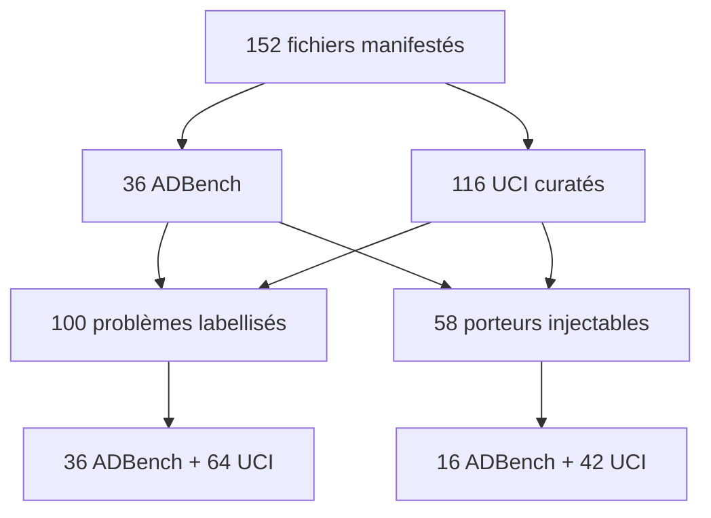

# Audit d'inventaire des jeux — 2026-11-07

## Populations et provenance

Le manifeste `pool_manifest.json` lie 152 fichiers à une URL et une empreinte.
Ils regroupent 36 jeux ADBench inclus (commit `3dac8221`) et 116 tables UCI
curatées. Les licences, dimensions, types, libellés et transformations par
table sont archivés dans `inventory.json`, `uci_curated.json` et
`uci_pool.json`; aucune donnée brute n'est distribuée dans le dépôt.

Les 100 problèmes labellisés sont 36 ADBench et 64 UCI. Les 58 porteurs
éligibles à l'injection sont une autre population: 42 UCI et 16 ADBench,
avec au moins 3 000 lignes, quatre colonnes continues et dix valeurs distinctes
après préparation. Les autres jeux sont exclus avec une raison dans
`typed/eligibility.json`. Un problème labellisé UCI est également un porteur,
mais une occurrence de problème, une table et une source ne sont pas des unités
indépendantes interchangeables.

## Sélection, labels et recouvrements

La sélection UCI requiert une licence ouverte, un téléchargement direct, 300 à
1 000 000 lignes, 4 à 300 variables et une tâche non textuelle/non séquentielle;
les doublons, jeux synthétiques et jeux de plateau sont exclus avec leur motif.
Pour les UCI labellisés, la classe la plus rare comptant au moins 20 lignes est
définie avant les détecteurs comme anomalie; au-dessus de 10 %, elle est
rééchantillonnée à 10 % et le taux naturel est conservé. Ce mapping de classe
ne transforme pas une minorité sémantique en faute ETL naturelle.

Le registre `UCI_SOURCES` relie les dérivations ADBench à leurs identifiants
UCI. Le rapport historique compte 19 occurrences ADBench/UCI présentes deux
fois; parmi les problèmes UCI labellisés, ces correspondances couvrent 15
identifiants source uniques, car plusieurs dérivations peuvent partager une
origine (par exemple trois variantes Landsat). Les statistiques par problème
ne sont donc pas une estimation fondée sur 100 sources indépendantes.

Water Quality reste hors pool: son label « non potable » est majoritaire
(environ 61 %), contraire à l'hypothèse d'anomalie rare; il est présenté comme
contre-exemple de régime, non comme une faute de qualité.

## Temps et partitions

Cinq problèmes labellisés ont une variable temporelle utilisable: Credit Card,
Bank Marketing, Occupancy Detection, Online Shoppers et Room Occupancy. Room
Occupancy est exclu du calcul chronologique car sa partition test contient zéro
anomalie. Les 11 tables UCI datées sans libellé ne définissent pas cette étude;
les fichiers ADBench ne portent pas de temps utilisable.

Les graines historiques sont archivées, mais les identifiants de lignes des
partitions ne le sont pas. T089 reste donc ouvert: ce document ne prétend pas
reconstruire ni certifier les splits historiques.
