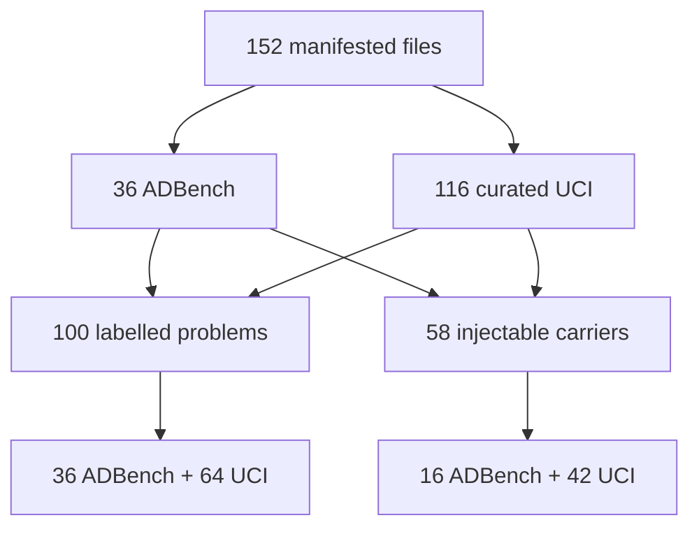

# Dataset inventory audit — 2026-11-07

## Populations and provenance

The manifest `pool_manifest.json` links 152 files to a URL and a checksum. They
consist of 36 included ADBench datasets (commit `3dac8221`) and 116 curated UCI
tables. Licences, dimensions, types, labels and per-table transformations are
archived in `inventory.json`, `uci_curated.json` and `uci_pool.json`; no raw
data is distributed in the repository.

The 100 labelled problems are 36 ADBench and 64 UCI. The 58 injection-eligible
carriers are a different population: 42 UCI and 16 ADBench, with at least 3,000
rows, four continuous columns and ten distinct values after preparation. The
other datasets are excluded with a reason in `typed/eligibility.json`. A
labelled UCI problem is also a carrier, but a problem occurrence, a table and a
source are not interchangeable independent units.

## Selection, labels and overlaps

UCI selection requires an open licence, a direct download, 300 to 1,000,000
rows, 4 to 300 variables and a non-textual, non-sequential task; duplicates,
synthetic datasets and board games are excluded with their reason. For labelled
UCI problems, the rarest class with at least 20 rows is defined as the anomaly
before any detector is run; above 10 % it is resampled to 10 % and the natural
rate is kept. This class mapping does not turn a semantic minority into a
natural ETL fault.

### Source overlap (recomputed)

The registry `UCI_SOURCES` links ADBench derivations to UCI identifiers. The
counts below are recomputed from the registry and from the archived per-problem
files by `tests/test_dataset_source_overlap.py`; they distinguish occurrences
from unique source identifiers.

| quantity | occurrences | unique UCI sources |
| --- | --- | --- |
| ADBench labelled problems with a UCI origin (of 36; `fraud` has none) | 35 | 30 |
| of those, sources also present in the 116-table UCI pool | 22 | 19 |
| of those, sources that are also one of the 64 labelled UCI problems | 17 ADBench problems and 15 UCI problems | 15 |

The figure of 19 reported in earlier documents is therefore the number of
unique UCI sources shared between the ADBench-derived problems and the full
116-table UCI pool. Among the 100 labelled problems the shared sources number
15, covering 32 problems (17 ADBench and 15 UCI). Several derivations can share
one origin (for example three Landsat variants). Per-problem statistics are
therefore not an estimate based on 100 independent sources.

Water Quality stays outside the pool: its "not potable" label is the majority
(about 61 %), contrary to the rare-anomaly assumption; it is presented as a
regime counter-example, not as a quality fault.

## Time and partitions

Five labelled problems have a usable time variable: Credit Card, Bank
Marketing, Occupancy Detection, Online Shoppers and Room Occupancy. Room
Occupancy is excluded from the chronological computation because its test
partition contains zero anomalies. The 11 dated unlabelled UCI tables do not
define this study; the ADBench files carry no usable time.

The historical seeds are archived, but the row identifiers of the partitions are
not. T089 therefore remains open: this document does not claim to reconstruct
or certify the historical splits.
