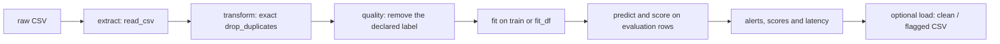
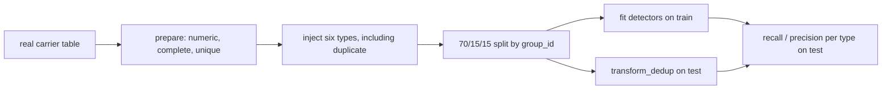

# Standard ETL path and typed fault-injection path — 2026-11-07

## Standard path

The demonstrator runs `run_pipeline`: CSV read, removal of exactly duplicated rows, detection, then optional writing of the clean and flagged rows. `detect()` removes the declared ground-truth column, fits the detector on `fit_df` when one is supplied, then predicts and scores every evaluated row. Learned detectors select the numeric columns, impute their medians and standardise with the values of the fit; the rules keep their own trained statistics. Continuous scores are oriented so that a higher value is more anomalous.

Standard deduplication deliberately precedes detection, so it can remove exact duplicates from the operational flow. It does not measure an anomaly detector. Benchmarks that evaluate duplicates report `transform_dedup` as a separate baseline, with no detection time, so that the transformation work is not credited to a detector.

## Separate typed-fault path

The typed study does not go through `run_pipeline`. It prepares a real numeric carrier, removes incomplete rows and duplicates *before* injection, then injects six fault types. The split keeps copies together by `group_id`, so an injected copy never straddles train and test. Injected copies remain available in the test partition; `transform_dedup` marks them by equality of the feature columns and is reported separately.

The two paths answer different questions. The first describes the operational ETL path; the second measures constructed faults on prepared carriers. Its results are not presented as natural incidents, and it does not rewrite the archives of the standard path.

## Historical limit

The historical `research.normalise.clean` protocol makes some schema and deduplication decisions before the train/validation/test split, so its results are kept as descriptive. The prospective consumer `research.pool_train_only` instead requires frozen partitions and fits its preparation decisions on the training partition. Recovering the historical partitions and replaying the studies remain necessary for T062 and T063.
