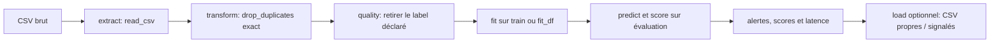
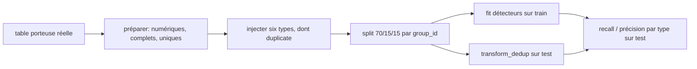

# Parcours ETL et parcours d'injection typée — 2026-11-07

## Parcours standard

Le démonstrateur exécute `run_pipeline`: lecture CSV, suppression des lignes exactement dupliquées, détection, puis écriture optionnelle des lignes propres et signalées. `detect()` retire la colonne de vérité terrain déclarée, ajuste le détecteur sur `fit_df` lorsqu'il est fourni, puis prédit et score toutes les lignes évaluées. Les détecteurs appris sélectionnent les colonnes numériques, imputent leurs médianes et standardisent avec les valeurs de l'ajustement; les règles gardent leurs propres statistiques entraînées. Les scores continus sont orientés de sorte qu'une valeur élevée soit plus anormale.

La déduplication standard est intentionnellement avant la détection: elle peut donc retirer les doublons exacts du flux opérationnel. Elle ne mesure pas un détecteur d'anomalies. Les benchmarks qui évaluent les doublons ajoutent plutôt `transform_dedup` comme baseline distincte, sans temps de détection, afin de ne pas attribuer au détecteur le travail de transformation.

## Parcours séparé des fautes injectées

L'étude typée ne passe pas par `run_pipeline`. Elle prépare un porteur réel numérique, retire alors les lignes incomplètes et les doublons *avant* l'injection, puis injecte six types de fautes. La division groupe les copies par `group_id`: une copie injectée ne traverse donc jamais train et test. Les copies injectées restent disponibles dans le test; `transform_dedup` les marque par égalité des colonnes de caractéristiques et est rapporté séparément.

Les deux parcours répondent à des questions différentes. Le premier décrit le chemin ETL opérationnel; le second mesure des fautes construites sur des porteurs préparés. Il ne transforme pas ses résultats en incidents naturels ni ne réécrit les archives du parcours standard.

## Limite historique

Le protocole historique `research.normalise.clean` prend certaines décisions de schéma et de déduplication avant la séparation train/validation/test. Il est donc conservé comme résultat descriptif. Le consommateur prospectif `research.pool_train_only` impose au contraire des partitions gelées et ajuste ses décisions de préparation sur le train; récupérer les partitions historiques et rejouer les études restent nécessaires pour T062 et T063.
